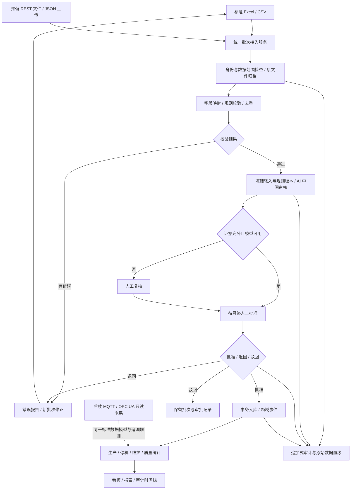

# IDMS 初期手动上传数据方案

版本：1.1.0；更新日期：2026-10-14；适用：离散制造企业、SaaS 和企业私有化。

## 1. 产品与实施范围

初期通过标准 Excel/CSV 文件收集企业已有台账、班次报表、停机表、维修表和质量检验表。企业选择行业模板、维护组织和设备编码、上传数据，即可逐步建立生产分析、维护分析、质量分析和审计追溯。自动设备采集不作为初期上线前提。

推荐采用“文件上传 + 统一批次接入服务”，让外部接口上传记录走同一校验、暂存、审批、入库链路。只做表单录入适合少量补录，但不适合企业历史数据；只做设备采集则依赖现场网络、点表和网关，实施周期较长。首期采用文件方式，保留表单补录和自动采集适配边界。

本文是新版需求与接口设计。2026-10-14已增加本机可操作Demo：上传中心、CSV/XLSX/JSON上传、五类校验、演示角色分工、人工终审、原文件和审计快照、已批准数据统计。真实AI、OIDC身份、生产数据库、对象存储、自动字段映射与更正版本仍待接入。具体已实现范围与演示步骤见 `demo-upload-guide.md`；目标架构不等于已完成商用部署。

## 2. 首期功能

| 模块 | 首期交付内容 | 后续扩展 |
| --- | --- | --- |
| 组织与设备 | 工厂/产线、设备编码、资产台账、所属范围 | 部件、测点、设备适配器 |
| 数据上传中心 | 模板下载、文件上传、字段映射、校验预览、错误下载、批次查询 | 定时 SFTP、客户专属字段映射模板 |
| 生产分析 | 班次产量、良品率、计划与实际时间、满足条件的 OEE | 订单任务、实时 CT |
| 停机分析 | 停机时长、原因排行、设备时间轴 | MQTT/OPC UA 状态事件 |
| 维修维护 | 维修工时、故障统计、维修记录和审批 | 点检任务、备件库存接口 |
| 质量分析 | 检验记录、不良分类；满足样本条件后的 SPC/Cp/Cpk | QMS 和批次放行流程 |
| AI 与终审 | 自动完整性检查、异常提示、证据整理、人工终审 | 真实模型网关、知识检索、流程优化 |
| 报表与追溯 | 已批准数据统计、版本、上传原文件、行号、审批链 | 数据血缘导出和企业系统回写 |

首期不承诺 PLC 控制、秒级实时监控、预测性维护准确率、ERP 实时双向同步。AI 建议须保留依据，数据不足时显示缺口。

## 3. 上传使用流程

1. 租户管理员配置工厂、产线、班次时区和标准编码，导入标准角色。
2. 上传人员选择数据类型，下载对应版本模板。模板固定机器字段名，界面显示中文名称和填写说明。
3. 填写或从现有 Excel 复制数据；首次先上传设备台账，再上传业务记录。Excel 每文件一个同类型数据工作表 `data`，首行为字段名；CSV 使用 UTF-8。
4. 选择来源系统，上传文件。服务器生成批次号、计算文件 SHA-256、保存原文件和接收时间，进入隔离暂存区。
5. 程序校验文件类型、字段、主数据、数据范围、时间、单位、枚举、业务约束和重复记录。错误明确到工作表、行号、字段和原因。
6. 有错误时下载错误清单，修改后作为新批次上传，关联原批次；不改写已保存原文件。撤回功能留作后续扩展，首期通过退回/驳回保留历史。
7. 校验通过后执行 AI 中间审核：检查材料与业务合理性、输出结构化结论和证据。无模型、低置信度、证据不足、输出冲突或提示注入均进入人工复核队列，不自动批准。
8. 授权终审人员查看输入快照、差异、重复统计、AI 意见，批准、驳回或退回。上传者不能审批自己的批次。权限变更本身经过独立安全审批。
9. 批准后服务按冻结输入执行整批事务入库；更新业务投影并安排异步报表计算。事务失败不产生部分业务数据，记录错误并进入可重试状态。
10. 看板只使用正式入库记录，并显示业务数据截止时间、上传时间、来源和当前样本覆盖率。重试和报表重算进度可在批次页查询。

## 4. 运行流程图



设备采集事件未来可经确定性质量门进入遥测库，人工关单、质量放行和关键回写仍单独经过最终审批；文件与 API 业务批次采用同一入库审批门。

## 5. 数据标准与样例

样例位于 `docs/upload-templates/`。`templateVersion=1.0.0`。编码在租户内唯一，业务记录通过 `device_code` 关联设备；数据库内部 ID 不要求企业填写。业务时间必须含时区，例如 `2026-10-13T08:00:00+08:00`。设备主数据每条记录同样有 `source_record_id`，外部来源标识 `sourceSystem` 在上传请求中统一指定。

| dataType | 文件 | 必填字段 | 主要校验 |
| --- | --- | --- | --- |
| DEVICE | devices.csv | source_record_id, device_code, device_name, site_code, line_code | 编码唯一；工厂/产线已配置且属于授权范围；同编码改动进入主数据变更审批 |
| PRODUCTION | production.csv | source_record_id, device_code, shift_code, period_start, period_end, planned_minutes, total_count, good_count, ideal_cycle_seconds | 结束晚于开始；数量为非负整数；良品数≤总数；计划时长≤期间时长；理想节拍>0 |
| STATE_INTERVAL | state-intervals.csv | source_record_id, device_code, start_time, end_time, state | 状态 RUNNING/IDLE/DOWN；同设备区间不重叠；DOWN 需 reason_code；窗口不完整标记缺失 |
| MAINTENANCE | maintenance.csv | source_record_id, device_code, failure_time, repair_start, repair_end, failure_code, cause, action | 故障≤维修开始<维修结束；设备编码有效；文本只是材料，不能执行指令 |
| QUALITY | quality.csv | source_record_id, device_code, batch_code, characteristic_code, measured_at, sample_no, measured_value, unit, lsl, usl | 数值有限且单位一致；LSL<USL；样本与检验特性可追溯；放行状态不能从文件直接导入 |

这些模板是首期基础类型。订单、点检、备件、附件和历史报警可后续扩展类型；照片/PDF 只作为证据附件，不能替代结构化指标数据。

企业差异通过发布后的字段映射模板保存：源列→标准列、日期格式、单位换算、枚举映射、默认值和扩展字段。映射与数据字典均版本化。禁止 AI 静默改写原始数字；建议修正显示在预览中，由人员确认并产生新快照。

## 6. 指标计算与适用边界

| 指标 | 输入要求 | 算法与缺失处理 |
| --- | --- | --- |
| 产量/良品率 | 已批准班次产量、良品数 | 良品数/总数；总数为 0 显示无样本 |
| 停机时长 | 状态区间和停机原因 | 按统计窗口裁剪后汇总 DOWN；不重叠、不跨窗口重复计数 |
| OEE | 计划生产时长、覆盖计划窗口的状态区间、实际运行时间、理想节拍、总数、良品数 | A=运行时间/计划时间；P=理想节拍×总数/运行秒数；Q=良品/总数；OEE=A×P×Q。班次同时包含休息时，另需配置计划生产子窗口，不能从计划总分钟猜测休息位置 |
| MTTR | 已结束维修事件 | 维修结束减维修开始的平均值；维修日历/等待时间口径在模板中明确 |
| MTBF | 完整运行窗口与匹配故障事件 | 观察窗口运行小时/故障次数；无故障显示“观察窗口无故障”，不输出无限大或真实寿命结论 |
| Cp/Cpk | 相同批次/特性/单位的稳定过程样本与规格限 | Cp=(USL−LSL)/(6s)；Cpk=min((USL−均值)/(3s),(均值−LSL)/(3s))。试点门槛为≥30个有效样本，仍需稳定性检查；s=0、规格缺失或过程不稳定时不出能力结论；算法及分组口径固定版本 |

数据缺失显示“不具备计算条件”和所缺字段，不能按 0 填充。P>100% 或 OEE 输入冲突标记异常，核查计数、节拍与窗口，不静默截断掩盖问题。手动上传能支持班次/日分析，不能还原文件中不存在的实时采样、报警发生过程或周期 CT。

样例中的 D-001 计划 480 分钟、运行 360 分钟、总数 1000、良品 980、理想节拍 20 秒，对应 A=75%、P≈92.59%、Q=98%、OEE≈68.06%。三条状态区间覆盖完整班次；单个质量样本只演示校验，不满足 Cp/Cpk 条件。

## 7. 校验、去重与更正

- 文件限制初始建议：CSV/XLSX ≤10 MiB、≤10,000 数据行；XLSX 展开内容≤50 MiB、≤100,000 单元格，限制处理时间。拒绝宏文件、加密文件、公式执行、外部链接和压缩炸弹；错误导出需防 CSV 公式注入。
- JSON 接口每请求≤1 MiB、≤500条；超限返回 413。多请求分别形成独立批次、独立审批；跨请求整批审批另行设计，不暗示现有支持。
- 业务校验错误进入批次错误报告；存在错误禁止批准整批。首期全有或全无，不默认跳过错误行。
- 当前记录唯一键为 `(tenant_id, source_system, data_type, source_record_id)`；普通上传同键同规范化内容为重复跳过，同键不同内容为冲突。审批预览须显示跳过数，提交时再次在事务内检查，防并发重复。显式更正模式保留同一来源记录ID，创建独立版本；只允许修改所引用已提交批次的记录，审批包冻结旧版本摘要并展示差异，不能覆盖历史。
- `Idempotency-Key` 在同租户、身份、路由范围绑定请求摘要；同键同请求返回原任务，同键异请求返回409。文件 SHA-256 不能替代记录级去重，换行格式改变仍须检测重复记录。
- 模板版本、映射版本、规则版本、原始快照和校验报告固定引用，不随最新配置改变。批准与入库时校验相关主数据版本；出现并发变更时停止入库、重新校验并重新批准。
- 已入库更正通过新批次和新记录版本追加，引用 `supersedes_batch_id`；原版本、原文件和原审批保留，重算受影响统计。禁止覆盖审计历史或用删除方式“修正”数据。
- 所有批准重试绑定批准时的快照摘要；服务崩溃通过事务标记/outbox 恢复，不复用旧审批导入变化后的内容。首期提交暂态故障按1/5/15秒最多自动重试3次，耗尽进入COMMIT_FAILED；唯一键冲突或主数据变化不自动重试，重新校验和审批。

## 8. 上传 API 与接口保留

独立契约：`docs/api/data-upload.openapi.json`，核心文件/JSON、批次、错误和审批接口已在本机Demo挂载，生产认证、字段映射、更正引用与完整异步队列仍属目标设计；Demo会拒绝尚不支持的字段。页面上传与第三方上传共享此协议和业务服务，API 路径统一 `/api/v1`。

| 方法 | 路径 | 用途 |
| --- | --- | --- |
| GET | /data-import-templates/{dataType} | 下载指定版本模板（CSV；XLSX 后续按格式扩展） |
| POST | /data-imports | multipart 文件上传并创建异步校验任务 |
| POST | /data-imports/records | JSON 结构化记录上传，供 ERP/MES/企业脚本调用 |
| GET | /data-imports | 分页查询批次，按状态、类型、时间过滤 |
| GET | /data-imports/{batchId} | 校验、AI、审批及提交状态与计数 |
| GET | /data-imports/{batchId}/errors | 分页获取行错误，保留 CSV 错误导出扩展 |
| POST | /data-imports/{batchId}/approval | 人工批准/驳回/退回；批准后触发服务端提交 |

生产身份使用 Keycloak OIDC/JWT 或企业服务账号 OAuth2 client credentials。`tenant_id`、调用方身份、角色和数据范围由验证后的令牌及服务端绑定产生；客户端 `X-Tenant-Id` 仅作为匹配上下文，不能覆盖令牌租户。所有查询、原文件下载、错误报告、暂存库和幂等存储必须同样隔离。

写请求需 `Idempotency-Key` 和 `X-Correlation-Id`；审批带 `expectedVersion` 防止并发。客户端不传审计字段、审批身份或系统内状态。第三方服务账号只上传和查询，不具备人工终审权限。JSON 和 multipart 的批次返回值一致，成功受理返回202，调用方通过状态查询获取结果。

修正未入库批次传 `predecessorBatchId`，引用同租户的校验失败/退回/驳回批次；更正已入库数据传 `supersedesBatchId`，进入显式更正模式并引用已提交批次。两者不能同时提供，且均需检查授权、类型与来源系统一致性；更正保留原来源记录ID、创建新版本，禁止修改未属于原批次的记录或新增未关联记录。提交事务比较旧版本摘要，有并发更正则返回冲突、重新校验和审批。

预留事件 `data-import.validated`、`data-import.awaiting-approval`、`data-import.committed`、`data-import.failed`。第一阶段轮询足够，Webhook 后续实现签名、重试和死信，不作为上传成功条件。MQTT/OPC UA 的后续接入继续保持只读。

## 9. 批次状态与审批边界

```text
RECEIVED → VALIDATING → REVIEWING → AWAITING_APPROVAL → COMMITTING → COMMITTED
                     ↘ VALIDATION_FAILED
                                   ↘ HUMAN_REVIEW → AWAITING_APPROVAL
AWAITING_APPROVAL → RETURNED / REJECTED
COMMITTING → COMMIT_FAILED（同一快照重试；变化后重新审批）
```

`VALIDATION_FAILED`、`RETURNED` 和 `REJECTED` 保留原批次，新上传创建新批次。`HUMAN_REVIEW` 的复核结果不等于最终批准。所有手工/API 业务批次进入正式数据库前均须人工终审，即便 AI 已通过。设备台账变更也不例外。导入维修结束时间只建立维修事实，不能自动关单；质量样本入库不能自动放行产品。

## 10. 权限与追溯

建议将以下权限加入现有角色目录，以版本1.1.0发布：`data-import:read`、`data-import:upload`、`data-import:approve`、`data-import:template-read`、`data-import:error-export`。具体分配参见 `docs/role-permissions.json`，生产实现还需按业务类型检查设备、生产、维修、质量操作权限及工厂/产线范围。上传权限本身不授予跨业务写入权。

审计员可查看批次但不能上传或批准；上传专员仅处理授权范围数据；终审员只能在授权范围人工批准且不得批准自己的上传；AI 和接口服务禁止调用批准接口。企业管理员可配置用户，不能更改已批准数据和审计记录。

每个结果能回溯到租户、来源系统、原文件/请求摘要、SHA-256、工作表/行号或JSON索引、上传人、业务时间、接收时间、映射/规则/模型版本、AI证据、复核人、终审人、快照摘要、入库事务和报表算法版本。源文件受独立授权下载与保留期管理，审计归档独立权限；哈希链验证可发现改动，但本身不等于第三方电子签章或不可篡改存储。

## 11. 技术路线与工具

首期继续复用现有 Node.js 24/TypeScript 模块边界与工作台，上传服务独立封装，避免为手动数据阶段同时重写 Java 后端和前端。SaaS 与私有化共用代码、迁移和模板；每企业独立业务数据库，控制平面保存租户路由。生产连接能力必须实际联调，不能仅依赖配置文件。

| 层 | 首期工具 | 演进 |
| --- | --- | --- |
| 前端 | 现有销售工作台扩展上传中心；正式界面可统一 Vue 3/TypeScript | 可复用映射配置与客户模板 |
| API/校验 | Node.js 24、TypeScript、JSON Schema/Ajv、流式 CSV 解析；XLSX 选择受维护解析库并固定版本 | Java 21/Spring Boot 可按产品团队情况后续迁移相同契约 |
| 业务/批次/暂存 | PostgreSQL，事务、唯一约束、数据库迁移 | 高并发租户路由、容量管理 |
| 文件 | 私有化 MinIO 或云端兼容 S3 对象存储、SHA-256 | 保留期、签名 URL、对象锁定与归档 |
| 任务/事件 | 首期 PostgreSQL 持久化任务表和 outbox | Redis 队列，量大后再考虑 Kafka/Redpanda |
| 身份/审批 | Keycloak + 服务端 RBAC/数据范围；持久化审批状态机 | 复杂 SLA 与补偿流程接 Flowable |
| AI | 可插拔模型网关，影子评测后启用；无模型转人工 | 企业知识库、云/本地混合模型 |
| 时序/采集 | 首期区间和班次数据可用 PostgreSQL | 高频采样启用 TimescaleDB、MQTT/EMQX、OPC UA 边缘网关 |
| 发布/运维 | Docker Compose 测试/试点、日志、备份、健康检查 | SaaS 或大规模私有化用 Kubernetes 与完整可观测平台 |

首期数据模型：`import_batches`、`import_rows`、`import_errors`、`source_files`、`field_mapping_versions`、`import_reviews`、`import_approvals`、`record_revisions`、`outbox_events`，关联现有设备、班次生产、状态区间、维修、检验和审计表。批次表含状态、版本、来源、快照摘要、模板引用、行数、审批和提交标识；字段中不保存明文访问密钥。

## 12. 实施路径与验收

参考排期为具备前后端与测试能力的小团队估算，非交付承诺：

1. 第1周：确定客户样表、字段字典、模板与指标口径，建立测试样本和数据范围。
2. 第2–3周：身份认证、PostgreSQL/文件归档、CSV 上传、规则校验、去重、错误下载和批次查询。
3. 第4–5周：XLSX 和映射模板、人工终审、事务提交、审计与数据报表；JSON 接口同服务联调。
4. 第6周：真实 AI 影子审核、失败转人工、试点培训、备份恢复和验收。AI 接入未就绪则以人工审核试运行，不宣称已实现自动中审。
5. 后续：企业接口自动上传、Flowable、MQTT/OPC UA、TimescaleDB；复用标准字段与数据血缘。

验收必须包括：

- 正确设备台账及依次上传的四类业务样例可预览、终审、入库并关联设备；未知设备、字段错误、越权工厂、时区错误返回逐行原因。
- 同文件重复上传、同业务ID重复、并发审批、同幂等键不同请求不会造成重复业务记录；相同ID不同内容触发冲突。
- 未终审不影响正式统计；服务账号/AI、自审、过期令牌、跨租户下载和审批全部拒绝。
- 入库故障无部分数据；重试不重复写入；原文件、旧版本、审批和报表可回溯。
- 样例 OEE≈68.06%，不足数据不输出 OEE/Cpk；手工数据不显示实时在线结论。
- 模型不可用或输出异常进入人工队列；文本提示注入不能跳过审批或执行设备控制。
- 修改映射和指标版本不改变历史记录；更正批次产生新版本与重算事件。
- 试点建议性能目标：10,000行≤60秒完成确定性校验（不含AI和人工等待），常用查询P95≤3秒；用实际试点硬件和文件集测量。
- 备份恢复演练、错误导出公式注入、XLSX 展开限额和对象存储隔离通过；未完成上述验证前仍属于演示/测试版。

企业需要准备：5类现有样表、组织/设备编码、班次日历、停机与故障字典、指标定义、上传人/终审人名单、数据保留期、试点设备范围，以及生产部署所需服务器、数据库和身份配置。初期无需先采购现场采集网关。
