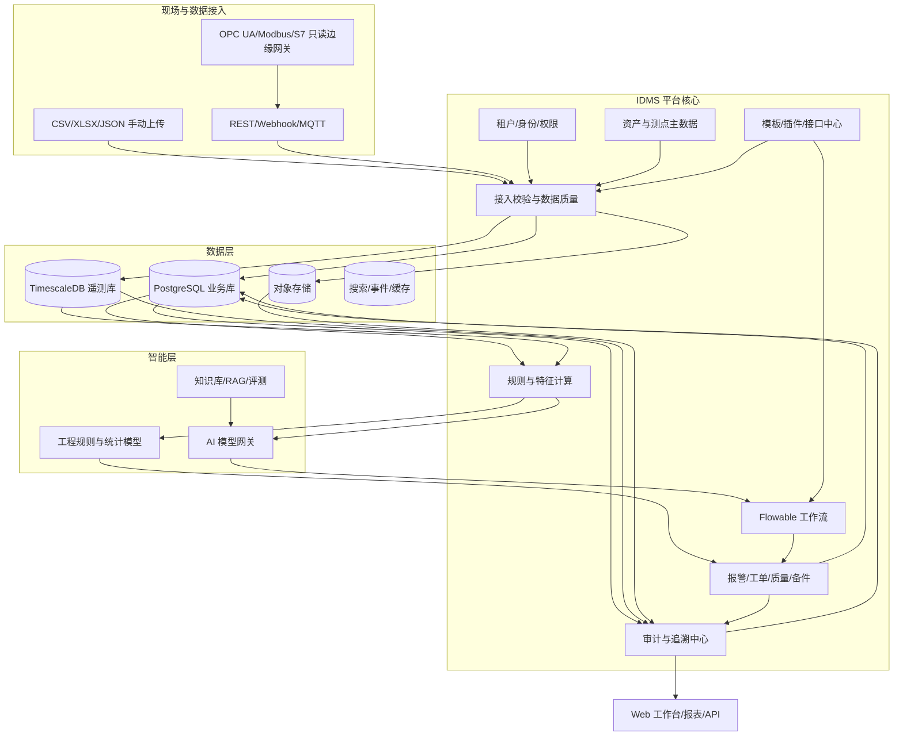

# IDMS 预测性维护产品架构与商业化分析

更新日期：2026-10-15

本文是产品架构和商业化设计，不等同于生产商用验收。当前本机版本已验证真实本地 AI 网关、PostgreSQL、Keycloak/OIDC、Flowable、OPC UA 只读模拟采集和 MQTT 链路；现场设备接入、模型精度、生产安全和灾备仍需企业试点验收。

## 1. 产品定位

IDMS 面向离散制造企业，把设备台账、手动上传数据、只读设备遥测、异常分析、维修工单、复测证据和审计追溯放在同一条业务链上。第一阶段的价值不是承诺“准确预测故障”，而是减少数据整理和人工巡检成本，让维修决策有证据、可复盘、可形成模型训练数据。

产品必须同时支持 SaaS 和企业私有化部署。客户差异通过行业模板、企业配置和签名插件解决，不建立客户源码分支。AI 负责结构化分析和中间审核，最终关单、质量放行、模板发布、权限变更和关键回写必须由独立授权人员批准。

## 2. 总体架构

### 分层职责

| 层 | 主要职责 | 关键约束 |
|---|---|---|
| 接入层 | 文件、API、MQTT、工业协议、身份联邦 | 幂等键、来源身份、租户上下文、时间和单位校验 |
| 业务核心 | 资产、测点、生产、报警、维修、质量、备件 | 事务一致性、版本冻结、状态机和权限校验 |
| 智能层 | 规则、特征、预测、AI审核、知识检索 | 证据绑定、失败关闭、模型版本和评测记录 |
| 流程层 | SLA、分派、升级、人工节点、补偿和回写 | Flowable实例与业务状态双向确认，禁止自审 |
| 数据层 | 业务事务、时序、原文件、搜索和事件 | 企业隔离、保留策略、备份、容量和恢复 |
| 治理层 | 模板、插件、审计、许可证、配额和运维 | 发布审批、签名验签、哈希链、可回放 |

### 推荐技术栈

- Web：Vue 3、TypeScript、Element Plus、ECharts。
- 核心服务：Java 21/Spring Boot 3 + 模块化边界；现有 Node.js API 作为迁移期兼容层。
- 工作流：Flowable；生产部署增加集群、任务锁、SLA和人工恢复策略。
- 数据：PostgreSQL 业务库，TimescaleDB 遥测，Redis 缓存，MinIO 原文件，OpenSearch 检索。
- 接入：MQTT/EMQX，OPC UA，后续 Modbus/S7；现场边缘节点使用 WAL、补传和证书。
- 身份与运维：Keycloak OIDC/SAML/LDAP/AD，OpenTelemetry、Prometheus、Grafana、Loki。
- 部署：试点 Docker Compose，SaaS 和大型私有化 Kubernetes。所有服务默认 TLS，生产禁止使用本机开发凭据。

## 3. 预测性维护业务闭环

1. 建立设备、部件、测点、量程、单位、工况和维护基线。
2. 初期使用模板上传设备、状态、生产、维修、质量和测点数据；后续由边缘节点上传只读遥测。
3. 对原始文件、行号、来源、时间、单位、质量标志和内容摘要进行冻结，错误数据停留在暂存区。
4. 计算趋势、阈值、变化率、频域/统计特征、OEE、MTBF、MTTR和停机模式。
5. 规则或经过评测的模型输出健康状态、异常原因、证据、风险和建议。RUL 没有真实故障标签和验证结果时显示“未评估”。
6. 报警进入 Flowable，生成维修任务；维修工程师填写原因、措施、备件、工时和复测证据。
7. AI 只做结构化中间审核和资料完整性检查；独立终审员批准关单或退回。
8. 把实际故障、维修结果和复测结果回写为训练/评测标签，并监控误报、漏报、漂移和节省的停机时间。

## 4. 当前功能缺陷和产品风险

### 已知实现缺口

| 缺口 | 影响 | 商用前的处理 |
|---|---|---|
| 当前预测器是可解释工程规则，不是经过现场验证的RUL模型 | 不能宣传故障概率、剩余寿命或精度 | 采集至少一个故障周期的标签；按设备和时间做训练/测试隔离，影子运行后再发布 |
| AI 网关默认 SHADOW，上传审核是抽样摘要 | 不能宣称逐行语义审核或自动放行 | 建立知识版本、RAG权限过滤、评测集、成本配额和流程级启用门槛 |
| TimescaleDB、对象存储、搜索、事件总线尚未完成生产化 | 高频数据容量、查询和归档能力不足 | 规范化表/ hypertable、分区保留、冷热归档、索引压测和恢复演练 |
| 现场接入仍以模拟OPC UA/MQTT为主 | 真实 PLC、CNC、传感器的协议、点表和证书风险未验证 | 现场勘查、点表签字、只读证书、断网补传和设备厂商验收 |
| 模板/插件治理还未形成完整证书链 | 客户扩展可能越权或破坏升级 | 签名、兼容矩阵、沙箱、资源限制、漏洞扫描和厂商审批 |
| 仅维修流程完成 Flowable 集成 | 质量、点检、保养、知识发布等流程仍需接入 | 每个责任动作使用独立流程版本、超时、升级和补偿测试 |
| 当前开发实例不是生产高可用部署 | 单点故障和恢复时间不满足企业SLA | 多实例、数据库高可用、备份、RPO 15分钟/RTO 4小时演练 |

### 产品设计风险

- 数据质量是最大风险。没有统一设备编码、时间区、工况和维修原因，算法会把录入误差当成设备异常。
- 预测维护需要“异常前数据 + 真实故障/维修标签”。只有正常数据时只能做状态监测和异常检测，不能承诺预测剩余寿命。
- 误报会造成维护疲劳，漏报会造成安全和信誉风险。上线前必须按设备、班次、工况分别披露误报/漏报和人工干预率。
- AI 的自然语言结论不能成为责任依据。必须保留原始证据、规则/模型版本、知识来源、人工意见和电子签名。
- SaaS 多租户的缓存、搜索、对象存储和日志很容易发生越权，必须把跨租户测试作为发布门禁，而不是只测试 API 参数。
- 设备控制接口会显著扩大安全边界。首版应保持只读采集；如以后增加参数下发，需单独的双人审批、安全联锁和网络隔离项目。

## 5. 商业化和盈利模式

### 建议的产品分层

| 套餐 | 目标客户 | 计费依据 | 核心内容 |
|---|---|---|---|
| 基础数据版 | 单工厂、数据刚起步的企业 | 工厂数/设备数/用户数 | 手动上传、主数据、报表、审计、API |
| 预测维护版 | 有稳定测点和维修团队的企业 | 设备或测点数 + 年订阅 | 时序分析、报警、工单、指标、模型评测 |
| 企业智能版 | 多工厂、集团客户 | 工厂数、数据量、AI调用量 | 多租户、SSO、知识库、AI网关、跨厂对标、SLA |
| 私有化版 | 数据不能出域或需要内网的客户 | 一次性许可 + 年维保 | 安装器、离线许可证、升级、现场支持和私有模型 |

### 增值收入

- 实施服务：设备盘点、点表映射、历史数据清洗、模板配置、UAT和培训。
- 连接器和插件：ERP/MES/QMS/WMS/EAM、OPC UA/Modbus/S7品牌适配，按连接器或项目收费。
- 行业模板：机加工、注塑、压铸、锂电、电子装配等按模板包授权。
- AI 用量：按模型调用量、token、设备分析窗口或高级模型包计费；私有模型按部署节点和算力计费。
- 高级服务：模型评测、漂移监控、灾备托管、7×24支持、审计留存和合规报告。
- 价值分成可作为补充：在能测量停机损失、备件减少或维护工时节省的客户中，按经双方确认的节省额收取服务费；不能作为所有客户的唯一收费方式。

### 定价和交付原则

首期报价应拆成“平台许可 + 设备/测点规模 + 连接器 + 模板/实施 + 运维服务”，避免无限定制导致毛利下降。标准客户目标实施周期为4-8周，客户差异中80%以上通过配置解决。合同应明确：数据归属、模型训练权、SLA、备份责任、现场协议范围、AI不保证故障预测结果，以及停机节省的核算口径。

### 关键经营指标

- 交付：标准项目上线周期、配置解决比例、模板复用率、接口交付周期。
- 产品：活跃设备数、有效测点率、数据新鲜度、报警确认时长、维修闭环率。
- 模型：每设备误报/漏报、提前预警时间、人工接管率、漂移率、评测集通过率。
- 商业：年度经常性收入、毛利率、续约率、客户获取成本、实施回收期、每客户支持工时。
- 价值：非计划停机时长、维修工时、备件库存、重复故障率和客户确认的节省额。

## 6. 建议落地路径

1. 先以手动上传 + 只读采集 + 可解释异常检测完成一个真实工厂试点，证明数据质量和维修闭环。
2. 再引入 TimescaleDB、现场协议、资产范围权限、对象存储和备份恢复，解决规模和运维问题。
3. 用维修结果建立故障标签，AI 先影子运行；只有评测和人工接管指标达标的流程才逐步开放低风险自动流转。
4. 最后开放模板市场、插件签名、许可证/配额、SaaS控制面和私有化安装升级，形成可复制销售的产品，而不是项目制源码交付。

