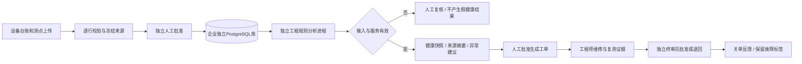
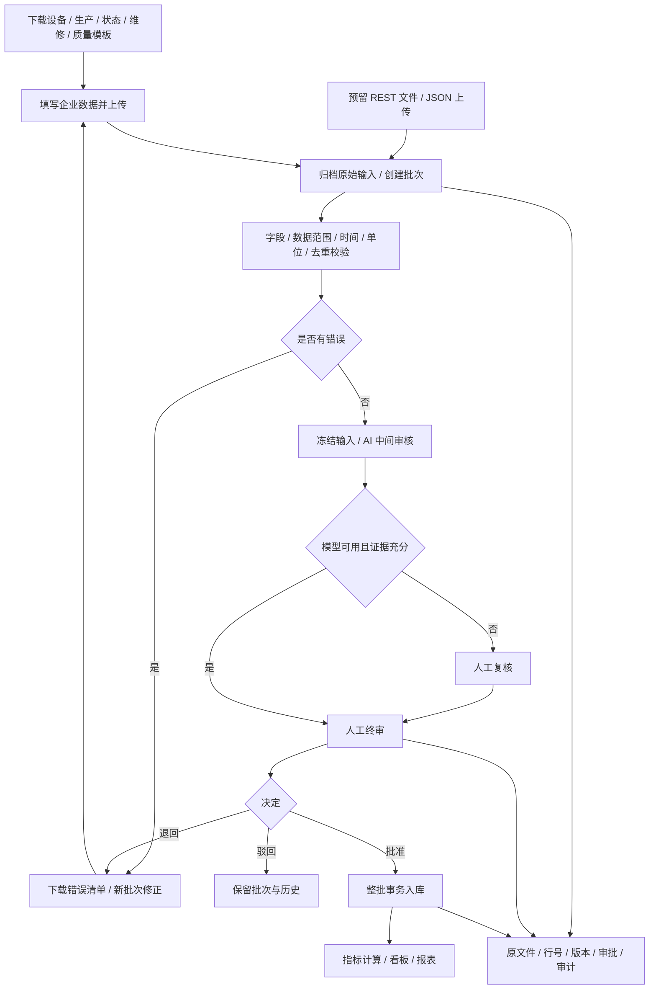
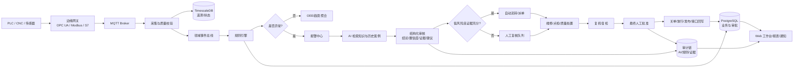
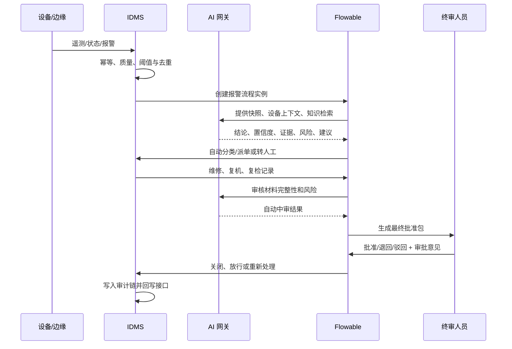

# IDMS 系统运行流程图与使用说明

## 最新方案 A 开发链路（2026-10-15）

企业维修模板已支持声明式字段、提交冻结、独立发布、导入导出及新工单版本绑定，详见 [模板治理与使用指南](template-governance-guide.md)。模板创建/编辑/提交者不可自审，旧工单不追改。插件清单可信验签不等于制品认证；当前插件执行仍阻断。

完整本机平台现使用Keycloak/OIDC真实登录，不再通过角色下拉框切换。认证 → 上传专员提交 → 独立终审 → 工程分析 → 终审批准建议 → 工程师领取工单 → 维修/复测 → 独立关单 → 审计。旧演示脚本仅适用于单独文件Demo。账号与当前实际权限边界见 `authentication-guide.md`。

当前运行状态和未完成项以 `scheme-a-development-status.md` 为准。PostgreSQL独立租户库、真实Keycloak/OIDC、独立工程分析、只读OPC UA/MQTT模拟采集、Flowable维修BPMN和本地真实AI网关已接通；AI仍为SHADOW且只审阅有界抽样摘要，现场设备及生产安全/运维仍未验收，不能作为商用交付。

启动 `启动IDMS.cmd`，打开 `http://127.0.0.1:4010/?view=predictive`。上传中心选择“设备测点”，使用样例前先批准设备台账。测点批准后进入预测维护运行分析；完整平台切换职责须退出并使用另一真实OIDC账户登录，不能在顶部选择身份。只有单独文件Demo保留演示身份选择器。

## 1. 初期运行流程：手动上传数据

更新日期：2026-10-14。初期以 Excel/CSV 上传为主，企业接口上传共用同一服务边界；本机Demo已实现上传、校验、规则模拟AI、人工终审、入库统计和追溯。下图是目标业务链路，生产数据库、真实模型等仍需接入。完整方案见 `manual-upload-idms-plan.md`，API设计见 `api/data-upload.openapi.json`，操作见 `demo-upload-guide.md`。

只有已批准并成功入库的数据影响正式报表。AI不能批准批次、关单或质量放行；上传人与终审人不同。手动数据看板按班次/日分析，显示来源与截止时间，不将其作为设备实时在线依据。

## 2. 后续自动采集目标流程

## 3. 后续报警到终审流程

以下是完整产品目标流程；目前已接通只读模拟采集与维修Flowable，真实AI及质量/知识/模板等其他工作流仍为后续目标。初期人工上传维修/质量事实也不能直接跳过对应终审。

## 4. 初期企业实施流程

## 5. 目标系统使用说明

本节为目标功能操作指南。当前新版Demo支持5类上传、规则模拟AI、人工终审、已批准记录统计、角色查看、接口说明及批次追溯；可配置组织、生产任务、真实AI和其他业务模块须进一步实现。

### 管理员首次配置

1. 在系统配置中创建工厂、车间、产线和设备层级。
2. 初期先上传设备台账，人工批准后依次上传班次生产、状态区间、维修和质量记录；单位、时区和停机原因须规范。后续设备采集再准备测点点表、协议和采样周期。
3. 导入 `role-permissions.json` 中的角色，给用户绑定角色和数据范围。
4. 选择离散制造标准模板，创建企业覆盖项；模板必须经过终审后发布。
5. 配置报警等级、阈值、持续时间、通知渠道、升级对象和流程 SLA。
6. 配置 ERP/MES/QMS/WMS 接口；所有写回接口使用版本号、幂等键和关联 ID。

### 数据上传使用

1. 按数据类型下载模板，填入企业编码与含时区时间。
2. 上传原文件，查看批次状态、字段预览、重复数与逐行错误。
3. 错误修正后上传新批次，引用原批次；不编辑已归档文件。
4. 校验和中间审核结束后，由另一名授权人员人工终审。
5. 批次成功入库后查看统计与业务数据截止时间；缺失数据会显示计算条件不足。
6. 按批次追溯原文件、行号、规则、AI意见、审批和数据版本；已入库更正需新批次审批。

### 设备与生产使用

1. 从运营总览查看设备状态、OEE、活动报警和待终审数。
2. 按已上传数据查看设备状态区间、MTBF/MTTR 和停机原因；不足以计算的指标显示数据缺口。接入高频采集后才提供实时趋势。
3. 在生产任务导入订单并完成模板校验，再将任务分配到产线或设备。
4. 设备报警后进入报警中心，确认、派单并记录维修原因、措施和复机结果。

### AI 与人工终审

1. AI 自动读取报警快照、设备上下文、历史工单和企业知识库。
2. AI 输出结构化结论、置信度、证据、风险和建议动作。
3. 低置信度、证据不足、冲突或高风险结果自动进入人工队列。
4. 终审人员检查证据、复测结果和责任边界，填写审批意见后批准、退回或驳回。
5. 只有批准后才允许关单、质量放行、模板发布、插件激活或关键接口回写。

### 追溯与导出

在追溯审计中按设备、报警、工单、模板版本或关联 ID 查询完整时间线。审计记录包含数据来源、规则版本、AI 模型、证据、人工审批人和接口结果；导出必须受 `audit:export` 权限控制并记录导出事件。

## 6. 当前 Demo 演示脚本

新版演示请使用 `demo-upload-guide.md` 中的8分钟流程：“模板→上传→校验错误→另一人批准→报表追溯”。下面是原报警Demo的历史讲解脚本，报警后端仍保留，但新版首页聚焦手动上传，不能将旧模拟实时指标作为真实客户数据。

1. 打开运营总览，说明设备透明、OEE、停机和数据完整率。
2. 进入报警中心，选择“主轴振动持续超限”。
3. 展示 AI 证据、置信度和建议维修动作。
4. 说明 AI 不能关单，进入人工终审并填写复测意见。
5. 批准关单后打开追溯审计，展示 AI、人工审批和审计哈希。
6. 打开模板中心与集成能力，说明同一套系统如何适配不同企业和私有化环境。
# 2026-10-15 工作流增量

维修工单现已增加真实Flowable BPMN集成：新工单使用引擎，旧工单保留历史状态机；命令待确认时不推进业务状态。最新运行架构、人工恢复与实测边界见 [Flowable工作流指南](workflow-guide.md)。本文件的完整产品流程仍作为业务目标概览，不代表所有模块均已完成。

