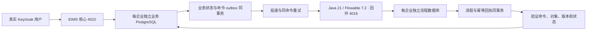
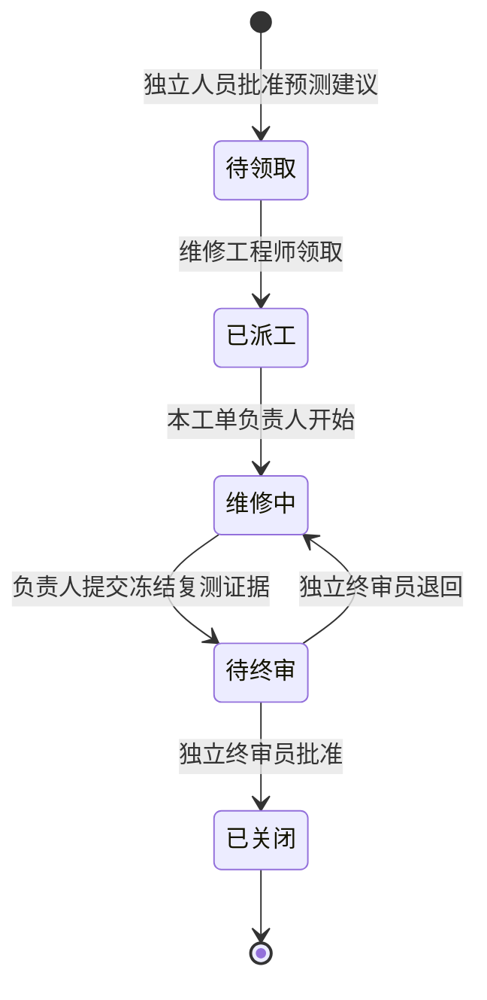

# Flowable 维修工作流开发集成

更新：2026-10-15。范围：真实 BPMN 维修流程及一致性集成；不是全部业务工作流平台或商用验收。

## 运行架构



- `services/workflow/`：Spring Boot 3.5.7 / Flowable 7.2.0；每企业独立引擎、数据源、流程库及服务令牌。
- `server/workflow.ts`：与租户业务事务共同写入 `workflow_outbox`；投递不在业务事务内进行。引擎成功但回执丢失时仍重试原命令 ID。
- 引擎重新校验内容摘要、用户身份类型、操作权限、业务版本、任务节点、维修证据和职责分离。服务接口不暴露任意流程部署、变量变更或脚本执行。
- 新工单固定引用创建时的 BPMN 定义 ID。引擎、命令回执和历史任务是真实数据库记录，不以业务页面状态冒充引擎执行。
- Java 端口仅绑定 `127.0.0.1:4016`，业务接口按企业服务令牌鉴权。开发环境凭据在受限 `.local/workflow/`，不得分享或加入发布包。

## 使用流程



1. 使用终审账户登录，在“预测维护”批准维护建议，创建待领取工单和流程命令。
2. 在“维修工单”观察 Flowable 同步状态。“命令待确认”不是业务已完成，此时禁止重复推进。
3. 维修工程师登录后领取并开始工单；填写故障代码、原因、实际措施、备件、工时和复测依据。
4. 提交证据后，必须由其他有终审权限的真实用户审核。即使维修人同时持有终审角色，也不得自审。
5. 退回后重新维修、重新提交证据并再次终审。重新提交不会沿用上一次审批。
6. 引擎确认终审后，本地才关单并更新对应预测告警与维护建议。“查看流程历史”展示真实任务、执行者和完成状态。

已有历史工单明确标识“历史兼容工单”，继续原状态机；不迁移、不补造 Flowable 历史。关闭历史工单仍执行原有真实身份和独立终审校验。

## 故障与人工恢复

| 状态 | 含义 | 操作 |
|---|---|---|
| PENDING | 命令已持久化，业务状态尚未推进 | 等待重试，可刷新；不得重复提交或手改数据库状态 |
| SYNCED | 引擎回执与冻结命令匹配，本地事务已提交 | 按当前任务操作 |
| HUMAN_REVIEW | 引擎拒绝、版本冲突或自动重试耗尽 | 核查服务和证据，由终审员点击“重试同一流程命令” |

- 自动投递每秒扫描，失败退避；达到重试上限进入人工处理。恢复不绕过审批，不创建替代流程，不修改原批准人身份。
- 轮询数据库暂不可用时保留持久化命令，不将工单自动标为成功。
- 人工恢复重发原命令。若存在真实版本/证据冲突，再次失败是正确行为；本批没有提供管理员强制跳步功能。
- 重启核心或引擎后继续原命令。已有 Flowable 工单但缺失客户端配置时，核心拒绝启动，禁止静默降级。
- 不向浏览器公开流程服务令牌、数据库密码或运行配置。

## 启动与检查

```powershell
npm run postgres:setup
npm run workflow:setup
npm run platform:start
```

便携 Maven 3.9.11、JDK 21 位于 `%LOCALAPPDATA%/IDMS/runtime/`。Maven 安装使用发布方 SHA-512 校验；平台管理程序自动构建和启动 Flowable，并验证所有企业的已鉴权状态。占用端口但身份无法验证的进程不会被自动杀死。

业务前端：`http://127.0.0.1:4010/?view=work-orders`，集成页面显示实时 Flowable 连通结果。此地址仅本机可访问。

API（均经现有 IDMS 身份、租户和权限控制）：

```text
GET  /api/v1/workflow/status
GET  /api/v1/work-orders/{id}/workflow
POST /api/v1/work-orders/{id}/workflow/retry
POST /api/v1/work-orders/{id}/claim
POST /api/v1/work-orders/{id}/start
POST /api/v1/work-orders/{id}/submit
POST /api/v1/work-orders/{id}/approval
```

写请求继续使用幂等键；浏览器还需 Origin 与 CSRF。正常工单操作提交版本，终审还需维修证据摘要。恢复接口仅有独立权限的真实用户可调用，且记录审计。

## 实测范围和证据

`npm run workflow:verify` 使用本次随机创建的四个隔离库/角色、独立端口和临时 Keycloak 用户/客户端。测试结束仅清理本次资源，不重置企业库。

- 真实 OIDC 领取、维修、独立终审和真实 Flowable 历史表；返回重修、再提交、关单反馈。
- 不可自审（包括叠加角色）；引擎重复校验 AI 身份、权限、证据摘要和版本；跨企业 API 和流程库 CONNECT 隔离。
- 请求内容 SHA-256 校验；重复命令同回执，同 ID 不同输入拒绝；引擎提交后丢失网络回执不创建第二实例。
- outbox 插入失败时业务/审计整体回滚；引擎已提交、本地确认事务失败后重试恢复。
- 引擎与核心同时重启恢复；自动重试耗尽转人工，人工仍重试同命令；缺失配置不可降级。
- 历史工单无虚构引擎记录，浏览器脚本无错误，桌面/手机布局无横向溢出。

结果：`outputs/workflow-verification.json`；截图：`outputs/demo-preview/22-flowable-history.png` 和 `23-flowable-mobile.png`。实际 4010 升级检查使用 `scripts/verify-live-workflow.mjs`，比较升级前后原上传/业务摘要，记录 `outputs/live-workflow-verification.json`。

## 尚未完成

流程设计器、模板审批发布、点检/质量/知识等其他 BPMN 流程、SLA/升级/补偿策略、生产 TLS/服务凭据轮换、迁移/应用权限分离、集群并发与压力测试、灾备和企业 UAT 均未完成。真实模型网关、TimescaleDB、经验证故障预测/RUL、商业授权与计费也不能因为本批 Flowable 通过而标为完成。
